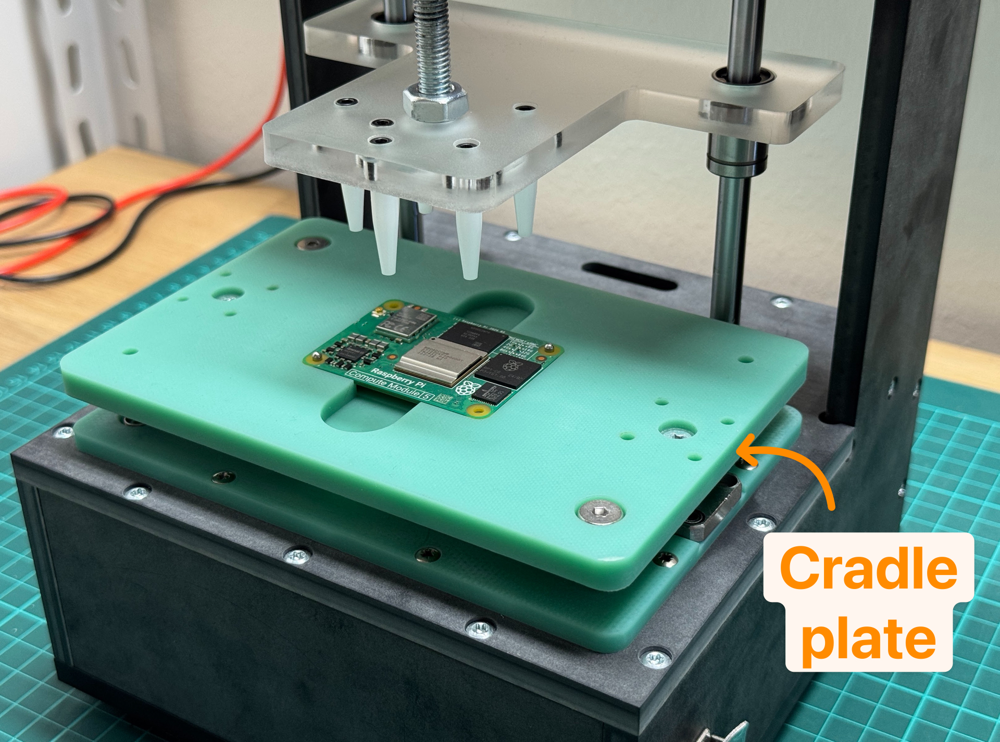
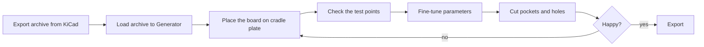
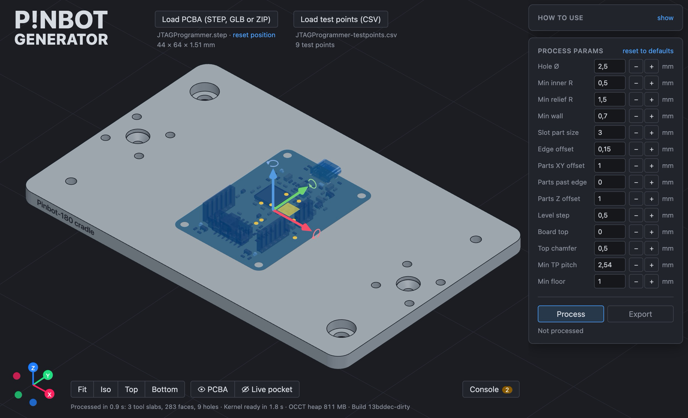
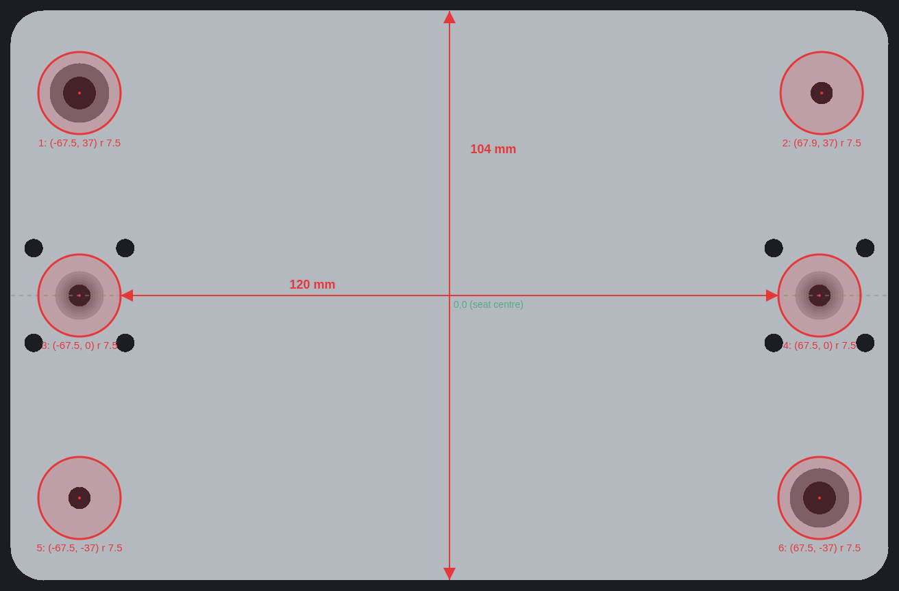
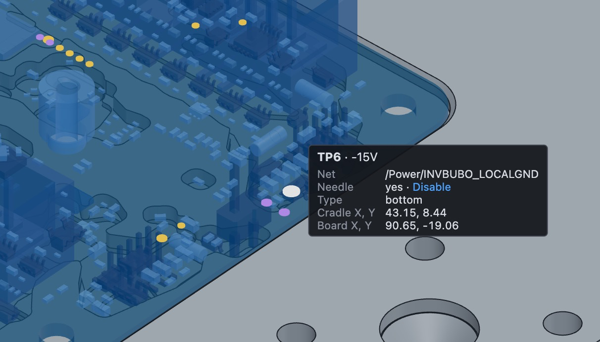
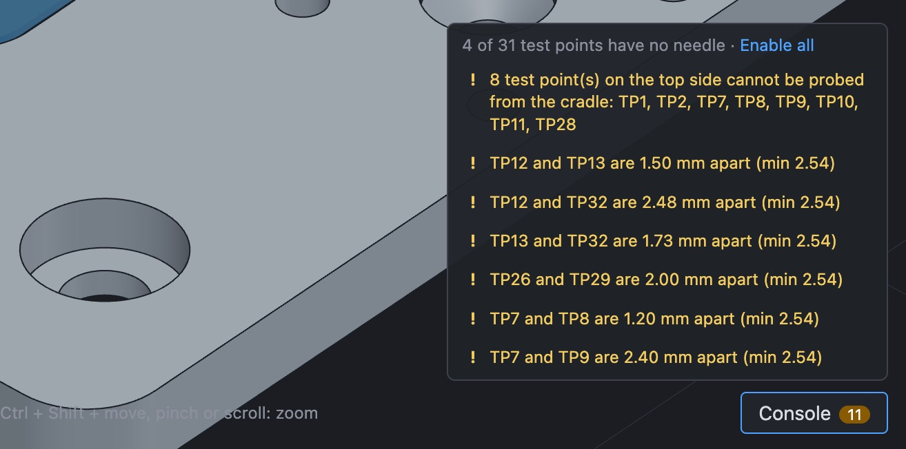

# Get started with cradle generator

!!! info "Everything stays on your machine"
    The generator runs entirely in your browser. Your board files are never uploaded anywhere.

The only truly custom part of a test jig is the cradle assembly (cassette) the board lies in. Its parts and assembly are covered in the Pinbot mechanics description. One of the most time-consuming tasks in the cradle design is preparing the pocket for your PCBA, taking into account all its features and the test points positions. [Cradle generator]() is our attempt to automate this process to cut the time it takes to design a cradle.

Pinbot [cradle generator]() runs in the browser and makes the **cradle** of a Pinbot-180 test jig for your PCBA: the plate the board lies in while spring-loaded test probes (needles) touch its test points from below.

The cradle plate needs two things cut into it:

- a **pocket** shaped to the underside of your assembled board, so it sits flat and in one place, with room for every part;
- a **hole** under each test point, for its probe needle.

You give it your board, it gives you a STEP of the finished cradle to adjust, to mill or 3D-print, and a `.csv` table of the holes.

<video src="images/get-started/hide-pcba.mp4" autoplay loop muted playsinline></video>

The main way to make a cradle is CNC milling. We do not recommend FFF printing, as its accuracy is insufficient and the materials are not stiff enough. That said, nothing stops you from trying.

!!! warning "Make sure every part is on the board model"
    The quality of the generated cradle depends on how complete your board's 3D model in ECAD is. If some parts are missing from the board model, the generator will not take their geometry into a pocket. [`kicad-export.py`](kicad-export.md) helps you find parts without models.

#### How it works

1. It projects every part of your board downward and stacks the outlines into a stepped pocket, with the clearances you set.
2. It drills a hole under every test point a needle can reach from below.
3. It cuts the pocket and the holes out of the cradle model and hands you the result.

## Your first cradle

Let's walk through the simplest example: generating a cradle for the Pinbot jig from your KiCad project.

1. **Export your board.** Run [`kicad-export.py`](kicad-export.md) on your KiCad project. You get one zip with the board model and its test points.

2. **Load it.** Drop the zip onto the view, or click **Load PCBA** at the top. The board and its test points appear in the cradle.

3. **Place the board.** Select the board, then move or turn it with its gizmo until it lies where you want it. You can flip board if needed. See [Moving and turning the board](#moving-and-turning-the-board).

4. **Check the test points.** Yellow markers get a probe needle, violet ones do not. Hover a marker to see details, and switch needles on or off. See [Test points and needles](#test-points-and-needles). Test points are found automatically by name, but you can also set them explicitly when you [export from KiCad](kicad-export.md).

5. **Tune the parameters.** Set clearances, offsets and the rest in **Process params** menu; the live pocket shows the effect in real time. See [Cutting parameters description](cutting-parameters.md).

6. **Process.** Press **Process** to cut the cradle. Read the console for warnings. Hide PCBA to check result. Repeat stages 4-6 till happy.

7. Press **Export** to download the cradle.

### Output files

Export downloads one zip, `YYMMDD_pinbot_<board>.zip`:

| File | What it is |
|---|---|
| `<board>.step` | The finished cradle, ready for CAD tweaking, CAM or a slicer |
| `<board>_holes.csv` | One row per needle hole: test point, net, XY in **the cradle's coordinates** |
| `report.txt` | Inputs, placement, parameters, result and warnings, so the cradle can be traced and remade |

## Basic features

Click the board to select it. The buttons at the bottom left frame the cradle:

- **Fit** keeps the current direction
- **Iso**, **Top** and **Bottom** look from there
- **Hide/show PCBA** hides the board, so you can check the resulting pocket
- **Hide/show Live pocket** hides the live outlines (red dotted) of the pocket to be cut

Camera controls may differ between operating systems. Rotation works with both a mouse and a trackpad.

| Action | How |
|---|---|
| Zoom | Scroll, pinch, or ++ctrl+shift++ + move |
| Pan | ++shift++ + move |
| Orbit | ++alt++ / ++option++ + move, about the point under the pointer |

### Loading the board and the test points separately

The archive from `kicad-export.py` loads both at once, but each can come on its own:

- **Load PCBA (STEP, GLB or ZIP)** takes a board model alone: a STEP or GLB file.
- **Load test points (CSV)** takes a table of test points, see [I don't use KiCad](#faq) in the FAQ.
- You can also drop a board file, a CSV, or both together onto the view.

A board loaded on its own clears test points loaded on their own, since they belonged to the previous board: load its CSV again.

!!! info "GLB loads much faster"
    A STEP of a large board may take tens of seconds to load. The same board as GLB takes a fraction of a second. `kicad-export.py` puts both in its archive, and the generator reads the GLB.

We strongly advise against loading boards much larger than the cradle (see [below](#placing-the-board-on-the-cradle)), as well as STEP files that carry data useless for cutting the cradle, such as multiple copper layers, silkscreen and solder mask layers. Large STEP files take much longer to load and use a lot of memory.

### Placing the board on the cradle

Click the board to select it. Its **gizmo** appears.

| Handle | What it does |
|---|---|
| Red and green arrows | Move the board in X or Y |
| Yellow square | Move the board freely in XY |
| Blue arrow | Raise or lower the board against the cradle top (the same as [Board top](cutting-parameters.md#board-top)) |
| Blue ring | Turn the board by 45° about Z |
| Red and green rings | Turn the board by 90° about X or Y, to put another side up |

- Turns go about the cradle's axes, as the rings show them.
- **reset position** under the board's file name puts it back where it was after loading.
- Click on empty space to deselect.

<video src="images/get-started/board-placement.mp4" autoplay loop muted playsinline></video>

!!! warning "Keep the board flat and inside"
    A board stood on its edge is a red error: turn it back with a ring. The board must also stay clear of the cradle's keepout areas; overlapping one is a red error too.

The cradle has keepout areas where the board should not be placed. The console warns you if it ends up there. Some large boards can overhang the edge of the cradle (if board design and test point placement allow it).

<figure markdown>
  
  <figcaption>Cradle keepout areas and dimensions</figcaption>
</figure>

### Live pocket

The red outline over the cradle's top is the 2D pocket as it will be cut, level by level. It follows every change:

- it moves with the board as you place it;
- it is rebuilt a moment after you change a parameter or a probe needle.

Use it to tune the parameters before you press **Process**. **Live pocket** in the bottom view bar shows or hides it; after Process the real cut takes its place.

<video src="images/get-started/live-pocket.mp4" autoplay loop muted playsinline></video>

### Test points and needles

Each test point is a 3D marker on the board:

| Marker | Meaning |
|---|---|
| Yellow | Gets a probe needle and a hole |
| Violet | No needle: the rules left it out, or you did |

Hover a marker for its tooltip: net, type (top, bottom or thruhole), coords rest. **Enable** or **Disable** in the tooltip switches its probe needle.

A test point gets no probe needle when it has copper on top only, lies outside the board outline, or a part covers it from below. You can still switch it on by hand.

In the cradle generator you can always disable individual test points and enable them back by hand. If some test points you need are missing after the board loads, or you want probe needles on the pins of other parts (like under PLS headers), set this up when you [export the project from KiCad](kicad-export.md#choosing-test-points).

### Console

**Console** at the bottom right lists every message, with a badge coloured by the worst: grey for information, yellow for warnings, red for errors.

- Hovering a message highlights the test points it is about.
- When test points have no probe needle, the console says how many. **Enable all** from the console to give every test poin a probe needle.

## FAQ

??? pinbot-question "I don't use KiCad. Can I still use cradle generator?"
    Yes. You need two files from your CAD tool, both in millimetres and from the **same origin**:

    1. **A STEP of the assembled board**, with its parts. The board itself should be the largest flat body. Do not include unnecessary data such a copper layers, silkscreen, masks etc in a STEP. It'll slow loading down.
    2. **A CSV of the test points**, loaded with **Load test points (CSV)**:

        | Column | Accepted names |
        |---|---|
        | Reference | `Ref`, `Reference`, `Designator` |
        | X | `PosX`, `X`, `Mid X`, `Center-X(mm)` |
        | Y | `PosY`, `Y`, `Mid Y`, `Center-Y(mm)` |
        | Side | `Side`, `Layer`: `top` or `F.Cu` for top, anything else is bottom |
        | Net (optional) | `Net`, `NetName`, `Name` |

        - Without a side column, every point counts as bottom test point.
        - A first line like `## Unit = in` switches the unit (`in`, `inch`, `mil`).
        - Only rows that look like test points are taken: reference `TP` and a digit, or `TestPoint` in the value or footprint name.

    **Y axiz points up**, as in KiCad's position files. If your markers land mirrored or off the board, check the origin and the Y direction of the CSV against the STEP.

??? pinbot-question "A test point I need has no marker"
    It was not recognised as a test point by cradle generator. From KiCad, give it the custom `Pinbot` field `probe`, or pass `--include`, see [Choosing what gets a needle](kicad-export.md#choosing-what-gets-a-needle).

??? pinbot-question "The pocket goes right through the cradle"
    Some cavity is so deep that its floor would be thinner than [Min floor](cutting-parameters.md#min-floor), so it is cut through. The console notes it. Lower the board with **Board top**, or accept the opening.

??? pinbot-question "Parts of my board are missing from the pocket"
    The generator only sees parts that have a 3D model. `kicad-export.py --check` lists those without one, see [Missing 3D models](kicad-export.md#missing-3d-models).

??? pinbot-question "Processing failed or the chamfer was not cut"
    Read the console. A chamfer that cannot be built is left out and the cradle is cut without it. If Process itself fails, try a slightly different [Edge offset](cutting-parameters.md#edge-offset) or [Min inner R](cutting-parameters.md#min-inner-radius), and report the board if it keeps failing.