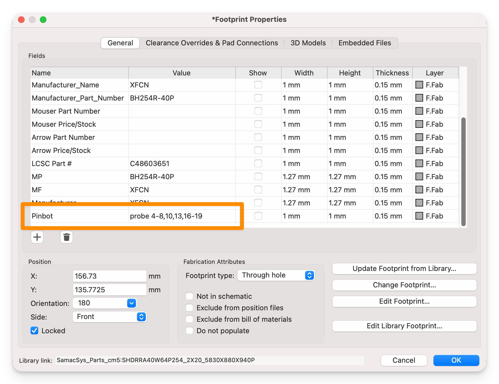

# Export PCBA from KiCad to cradle generator

`kicad-export.py` turns a KiCad board into one zip archive that [Pinbot cradle generator](/generator) loads in a single step. The archive holds the board model, its test points and a traceability report. **Your board file is never changed** while script makes it is whole copy to process.

``` title="Requirements"
- Python 3.9+ with no extra libs required
- KiCad 8+ with kicad-cli
- PCBA files in KiCad5+ format
```

[:lucide-download:  Download kicad-export.py](https://github.com/Pinbot-factory/pinbot-cradle-generator/blob/main/scripts/kicad-export.py){ .md-button .md-button--primary }
{ style="text-align: center" }

## Quick start

```bash title="Export one board"
python3 kicad-export.py path/to/board.kicad_pcb -o out/
```

``` title="Example output"
$ python3 kicad-export.py /hw/twonkie.kicad_pcb -o /tmp/zips/

tmp/boards/dojoe__Twonkie/hw/twonkie.kicad_pcb
  board  25.4 × 25.4 mm, 3 test points (3 bottom), format 20240108
  · 3 test point(s) excluded from position files are exported anyway: TP1, TP2, TP3
  ! 4 part(s) under the board or with leads through it have no 3D model the export can load: DS1, J1, J3, U1; the cutter does not see them and cuts no room for them
  GLB   0.7 s
  STEP  0.6 s
  CSV   0.2 s
  → tmp/zips/261109_pinbot-board_twonkie.zip (0.6 MB)
```

Then open [Pinbot generator](/generator) and drop the resulting zip onto the view.

## More ways to run
=== "A project file"

    ```bash
    python3 kicad-export.py path/to/board.kicad_pro -o out/
    ```

    The `.kicad_pcb` next to the project file is exported.

=== "A whole folder"

    ```bash
    python3 kicad-export.py path/to/projects/ -o out/
    ```

    Every `.kicad_pcb` under the folder is exported. Hidden folders, backup folders and `_autosave` files are skipped.

=== "Check only"

    ```bash
    python3 kicad-export.py path/to/board.kicad_pro --check
    ```

    Runs the checks and exports nothing. Fast, and works without KiCad installed.

=== "Faster, without STEP"

    ```bash
    python3 kicad-export.py path/to/board.kicad_pcb --no-step -o out/
    ```

    The STEP export is the slowest step. The generator reads the GLB first, so you can leave the STEP out.

For each board the script prints its size and test points, the checks, every `kicad-cli` stage with its time, and the archive.

| Option | Default | |
|---|---|---|
| `targets` | | `.kicad_pcb` or `.kicad_pro` files, or folders to search |
| `-o`, `--out DIR` | current folder | Where resulting archives go |
| `--check` | | Check, export nothing; needs no KiCad. Use for automation or CI |
| `--no-step` | | Do not export STEP. Increase export speed. |
| `--include REF[:PINS]` | | Probe a part's pins; repeatable, patterns allowed |
| `--exclude REFS` | | Leave test points out, e.g. `TP7,TP1*` |
| `--kicad-cli PATH` | found automatically | The `kicad-cli` to use |
| `--source URL` | git remote `origin` | Repository named in `report.txt` |
| `--no-dnp` | | Leave *Do not populate* parts out of the models |
| `-q`, `--quiet` | | Print only errors and archive paths |
| `-v`, `--verbose` | | Also print `kicad-cli`'s warnings |
| `--version` | | Script version and archive format |

## Choosing test points
A footprint automatically counts as a test point when any of these holds:

- its reference is `TP` followed by a digit: `TP1`, `TP23`;
- its value contains `TestPoint` or `Test_Point` (any case);
- its footprint name contains `TestPoint` or `Test_Point` (any case).

This is the same rule the cradle generator uses for any position CSV you load by hand.

!!! info "Test points excluded from position files will be exported anyway"
    KiCad's test-point footprints are often marked *Exclude from position files* or DNP. The script exports them regardless, and says so in its checks. You can disable them later in cradle generator.

### Custom KiCad field for components

To change what gets a needle, add a field named `Pinbot` to a footprint in KiCad. The choice then lives in your project and survives every export. This would **work with any part which has pins**. PLS headers pins, ICs, caps — whatever.

<figure markdown>
  
  <figcaption>Custom field set in KiCad Footprint Properties</figcaption>
</figure>

To add custom field to a part:

1. In the PCB Editor, select the footprint and press ++e++.
2. In the **Fields** table, click **+** to add a field.
3. Name it `Pinbot` and enter the value. See table below.
4. Click **OK** and save the board.

| Value | What it does |
|---|---|
| `probe` | Needles on every pin of this part that has copper, e.g. a 2.54 mm header |
| `probe 1-4,6,12-18` | Needles on these pins only. Ranges work for numbered pins; other names are listed as they are, e.g. `probe A1,B2` |
| `skip` | Leaves this test point out of the export |

### Test points filtering thru cli

The same choices are available as options, for one run. They take precedence over the field.

```bash title="Examples"
python3 kicad-export.py board.kicad_pro -o out/ --include J1  # (1)!
python3 kicad-export.py board.kicad_pro -o out/ --include J3:1-4,6  # (2)!
python3 kicad-export.py board.kicad_pro -o out/ --exclude 'TP7,TP1*'  # (3)!
python3 kicad-export.py board.kicad_pro -o out/ --include J1 --include J3:1-4,6 --exclude TP7  # (4)!
```

1. Every pin of `J1` with copper gets a needle.
2. Only pins 1, 2, 3, 4 and 6 of `J3`.
3. `TP7` and every test point whose reference starts with `TP1` are left out. Quote patterns with `*` or `?`, or your shell expands them as file names.
4. Combined.

- References may be patterns: `*` matches anything, `?` one character.
- `--include` may be given several times. It also brings back a part whose field says `skip`.
- `--exclude` takes a comma-separated list and may be given several times.
- A pattern that matches nothing is a warning, so a typo does not go unnoticed.

## What is in the archive

```text title="261111_pinbot-board_sensor.zip"
sensor.glb                 # board and parts as meshes
sensor.step                # board and parts as solids
sensor-testpoints.csv      # what gets a probe needle
report.txt                 # where it came from, checks, kicad-cli notes
```

### The test-point CSV

It is KiCad's own position file (`kicad-cli pcb export pos`, CSV, millimetres, both sides, drill/place origin), cut down to what gets a needle, with three columns added:

``` title="Test points CSV example"
Ref,Val,Package,PosX,PosY,Rot,Side,Copper,Part,Net
"J1-1","SWD","PinHeader_1x04_P2.54mm_Vertical",20.000000,20.000000,90.000000,top,both,J1,"/SWDIO"
"J1-2","SWD","PinHeader_1x04_P2.54mm_Vertical",22.540000,20.000000,90.000000,top,both,J1,"GND"
```

| Column | From | Meaning |
|---|---|---|
| `Ref`, `Val`, `Package`, `PosX`, `PosY`, `Rot`, `Side` | KiCad | As KiCad writes them; `Side` is the side the footprint sits on |
| `Copper` | The board file | The sides the pad has copper on: `top`, `bottom` or `both` |
| `Part` | The script | The part a row belongs to: its own reference, or `J1` for pin `J1-1` |
| `Net` | The board file | The pad's net; the generator's hole table names it |

!!! info "Why `Copper` and not just `Side`"
    `Side` tells where the footprint sits, not where its copper is. A footprint on top may carry its pad on the bottom layer, and a castellated pad has copper on both sides. The generator decides which test points a needle can reach from `Copper`.

 Cradle generator sorts every test point into one of three types, from `Copper` first:

| Type | When | Needle |
|---|---|---|
| `thruhole` | Copper on both sides, or a hole drilled through the board under the point | Yes, from below |
| `bottom` | Copper on the bottom side only | Yes |
| `top` | Copper on the top side only | No: a needle comes from below and cannot reach it |

Without a `Copper` column (a CSV not made by this script), the generator falls back on `Side` and the hole under the point.

## Troubleshooting

### Missing 3D models

The generator cuts room only for parts it can see. A part under the board, or with leads through it, needs a 3D model, or the board will rest on it.

- Run `--check` and read the warning: it names the parts.
- For each part, open its footprint properties by pressing ++e++ and look at the **3D Models** tab.
- If the path uses a custom variable, define it in KiCad: **Preferences → Configure Paths**.
- If the model file is not in the repository, add it, or point the footprint to a model from KiCad's library.
- If the part is not fitted during the test, mark it *Do not populate*: it is then listed apart and needs no room.

!!! example "Screenshot: the 3D Models tab with a missing file"
    KiCad Footprint Properties, **3D Models** tab, for a connector `J3`. The model path `${MY_LIB}/conn.step` is shown with KiCad's red "file not found" marker, and the preview pane is empty.

### Missing test points

Check testpoints reference, value and footprint name against [the rule](#the-test-point-csv). If it does not match, add `Pinbot = probe` to it or use `--include` [as described](#choosing-test-points).

### Missing kicad-cli

Script will find it automatically. If not, use `--kicad-cli PATH` option. Typical locations are:
=== "macOS"

    ```text
    /Applications/KiCad/KiCad.app/Contents/MacOS/kicad-cli
    ```

=== "Windows"

    ```text
    C:\Program Files\KiCad\<version>\bin\kicad-cli.exe
    ```

    The newest installed version wins.

=== "Linux"

    ```text
    /usr/bin/kicad-cli
    /usr/local/bin/kicad-cli
    ```
