# Cutting parameters

The **Process params** block sets how the pocket under the board is cut. All values are in millimetres.

- Any change is shown at once in the live pocket outline over the cradle.
- A change clears the last Process result: press **Process** again to cut with it.
- **Reset to defaults** in the block's header brings every value back.

| Parameter | Default, mm | Description |
|---|---:|---|
| [Hole Ø](#hole-diameter) | 2.5 | Needle holes |
| [Min inner R](#min-inner-radius) | 0.5 | Tool radius in inside corners |
| [Min relief R](#min-relief-radius) | 1.5 | Corner reliefs on the board outline |
| [Min wall](#min-wall) | 0.7 | Thinnest wall left between cavities |
| [Slot part size](#slot-part-size) | 3 | Small cavities joined into slots |
| [Edge offset](#edge-offset) | 0.15 | Gap around the board |
| [Parts XY offset](#parts-xy-offset) | 1 | Gap around parts |
| [Parts past edge](#parts-past-edge) | 0 | Part cavities past the board outline |
| [Parts Z offset](#parts-z-offset) | 1 | Extra depth under parts |
| [Level step](#level-step) | 0.5 | Depth grid of cavity floors |
| [Board top](#board-top) | 0 | Board height against the cradle top |
| [Top chamfer](#top-chamfer) | 0.5 | Chamfer on the pocket rim |
| [Min TP pitch](#min-tp-pitch) | 1.27 | Warning for close test points |
| [Min floor](#min-floor) | 1 | Thinnest floor under a cavity |

---

## Hole Ø { #hole-diameter }

**Default:** 2.5 mm · **Range:** above 0

Diameter of the hole drilled through the cradle under each test point that gets a needle. Match it to the needle's receptacle.

Holes closer than [Min wall](#min-wall) to each other or to a cavity are joined to it, see [Slot part size](#slot-part-size).

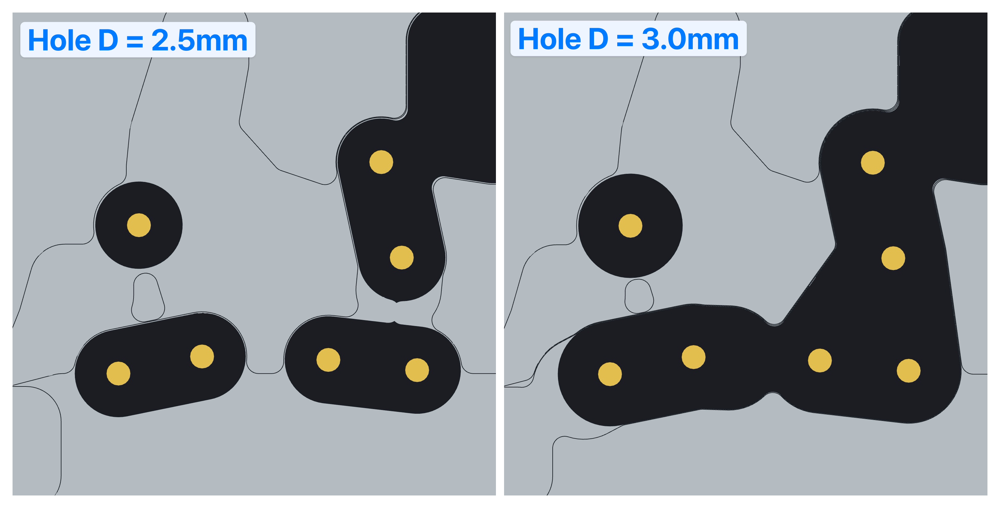

## Min inner R { #min-inner-radius }

**Default:** 0.5 mm · **Range:** 0 to 1.5

The smallest radius of an inside corner of the pocket. It could be the radius of your smallest end mill. No corner is cut sharper than the tool can.

- Where a part's corner is sharper than this, the pocket gets a relief, a small round cut-out that leaves room for the corner.
- **0** turns it off: corners are cut sharp.

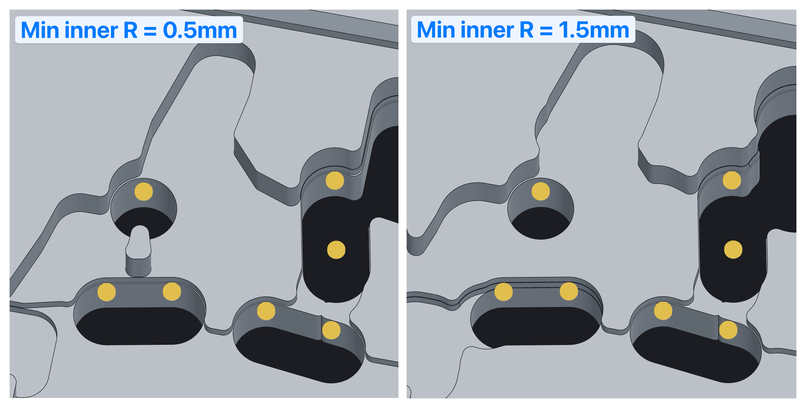

## Min relief R { #min-relief-radius }

**Default:** 1.5 mm · **Range:** 0 to 3

The size of the corner reliefs on the board outline. A relief is never smaller than this, nor than [Min inner R](#min-inner-radius).

- Reliefs go on real corners of the board, where it turns by 30° or more. Bevels made of two shallow corners get none.
- Notches in the board edge narrower than twice this value (castellated holes, small slots) are filled by the pocket instead of followed, so the cradle has no thin teeth.
- Component cavities get no reliefs, only the board outline.

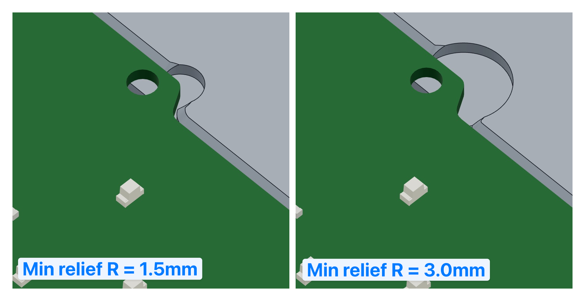

!!! info "Why reliefs"
    Round reliefs at the corners let the board drop in and come out easily, and prevent dust collecting.

## Min wall { #min-wall }

**Default:** 0.7 mm · **Range:** 0 and above

The thinnest wall of material the pocket may leave between two cavities, or between a cavity and a hole. A thinner wall would break or could not be milled, so it is removed and the two are joined.

- Small cavities and holes join as straight slots.
- A hole next to a large cavity gets a straight slot to it.
- Loose islands of material thinner than this everywhere are cut away too.
- **0** turns joining off.

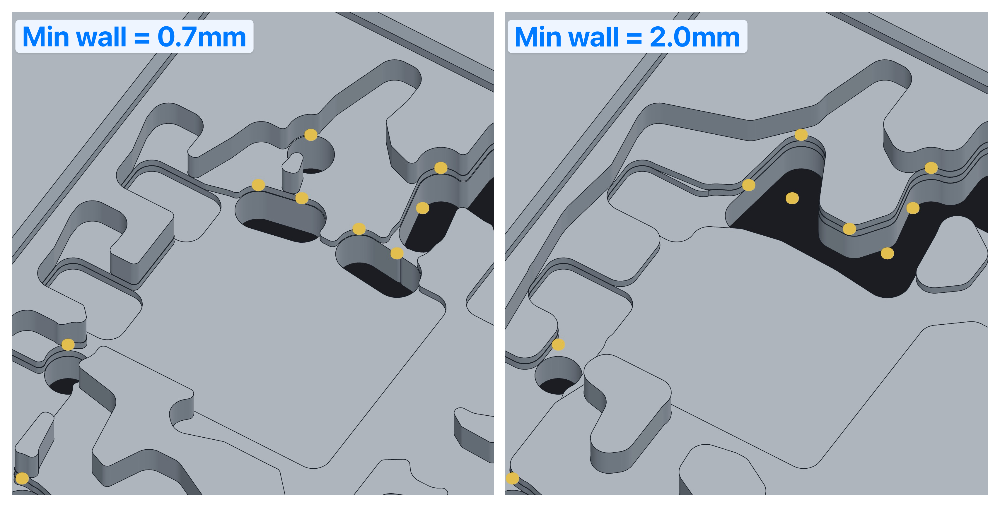

## Slot part size { #slot-part-size }

**Default:** 3 mm · **Range:** 0 and above

Leads and parts up to this size across, and all probe needle holes, join their close neighbours as straight slots: a row of leads at 2.54 mm becomes one slot instead of a beaded wall.

Larger parts keep their own outline.

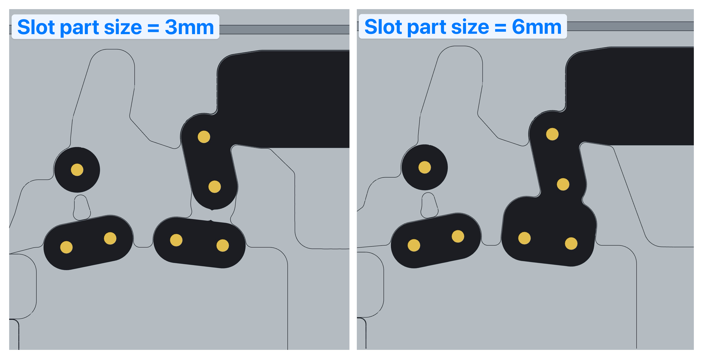

## Edge offset { #edge-offset }

**Default:** 0.15 mm · **Range:** 0 and above

The gap between the board's outline and the pocket wall. It sets how precisely the board is held: the smaller, the tighter.

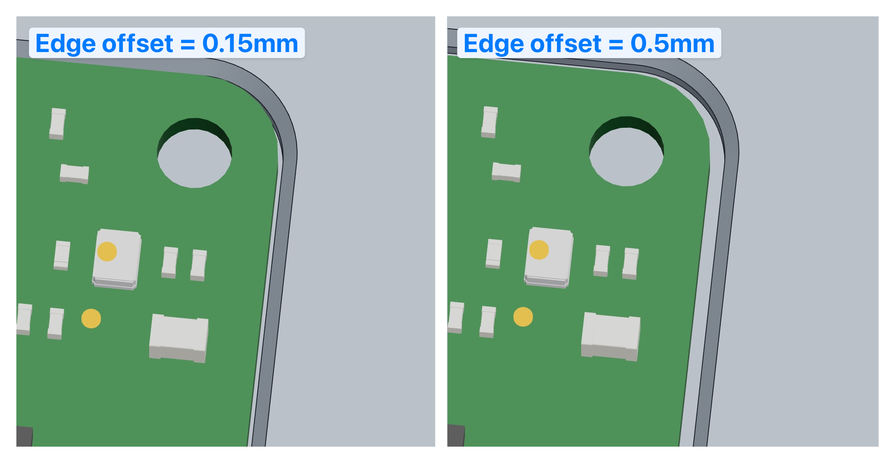

## Parts XY offset { #parts-xy-offset }

**Default:** 1 mm · **Range:** 0 and above

The gap around every component under the board, in XY. This is to balance parts gaps (you want them bigger) and board support area (you also want to keep it big).

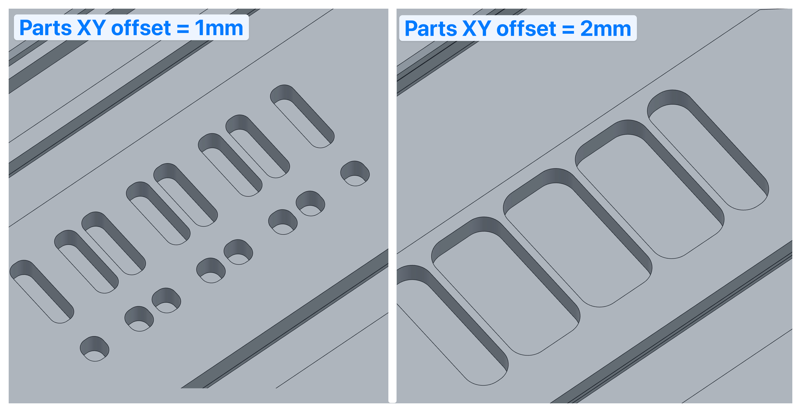

## Parts past edge { #parts-past-edge }

**Default:** 0 mm · **Range:** 0 and above

How far a part's cavity may reach past the board's outline, beyond the [Edge offset](#edge-offset).

- **0:** a part close to the edge does not cut past the pocket wall, so the board still sits firmly along its whole outline.
- Larger values give such parts their full [Parts XY offset](#parts-xy-offset) back, up to this distance.
- Parts that overhang the board, like a connector sticking out, always keep their whole offset.

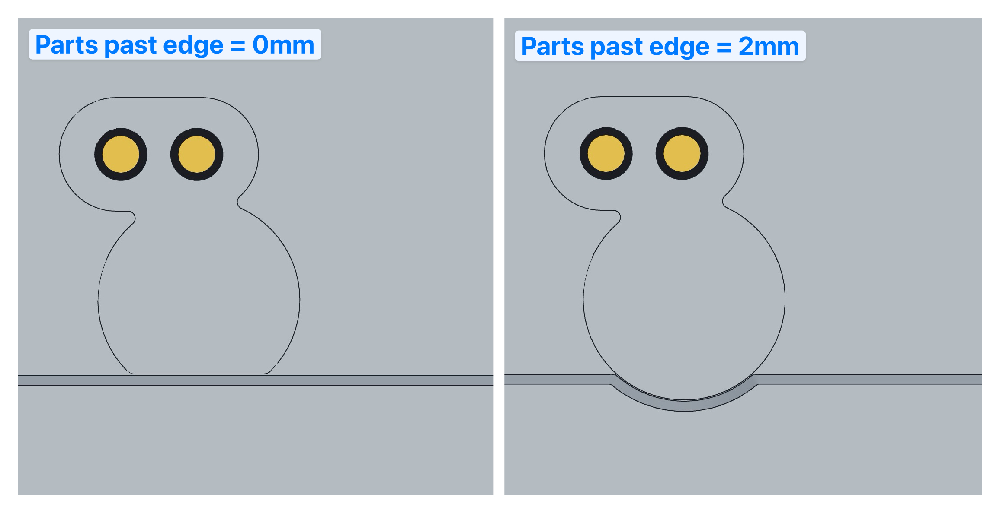

## Parts Z offset { #parts-z-offset }

**Default:** 1 mm · **Range:** 0 and above

Extra depth under every component, so the part does not touch its floor. The board rests on the pocket's seat, not on its parts.

<!--  -->

## Level step { #level-step }

**Default:** 0.5 mm · **Range:** above 0

Cavity floors are rounded down to this levels. Parts of similar height then share one depth, so the pocket has fewer levels and is quicker to mill.

- Smaller: floors follow the parts more closely, with more levels.
- Larger: fewer levels, some cavities deeper than needed.

<!--  -->

## Board top { #board-top }

**Default:** 0 mm · **Range:** neg / pos

The height of the board's top surface against the top surface of the cradle.

- **0:** the board's top is flush with the cradle's top.
- Positive: the board sits higher and the pocket is shallower.
- Negative: the board sinks deeper into the cradle.

The Z arrow (vertical, blue) of the board's gizmo sets the same value.

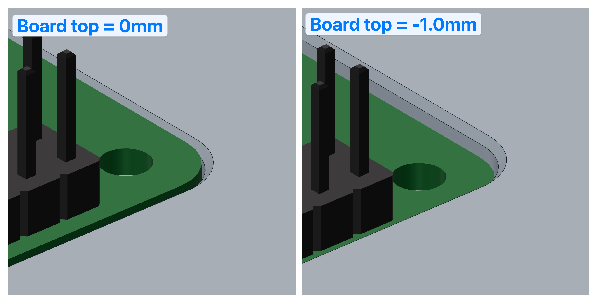

## Top chamfer { #top-chamfer }

**Default:** 0.5 mm · **Range:** 0 to 1

A 45° chamfer along the pocket's rim at the top of the cradle, so the board finds its way in. **0** turns it off.

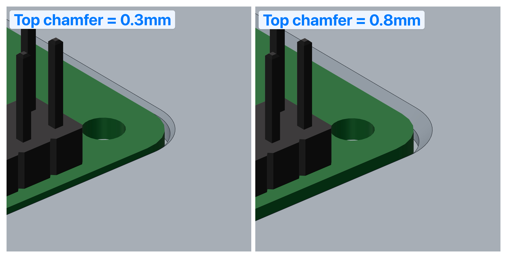

!!! note "When the chamfer is not cut"
    If the chamfer cannot be built for a given pocket, the cradle is cut without it and the console signaling.

## Min TP pitch { #min-tp-pitch }

**Default:** 1.27 mm · **Range:** 0 and above

The console warns when two test points with needles are closer than this. It changes nothing in the cut.

Set it to the closest pitch your needles allow. Switching one of the two needles off clears the warning.

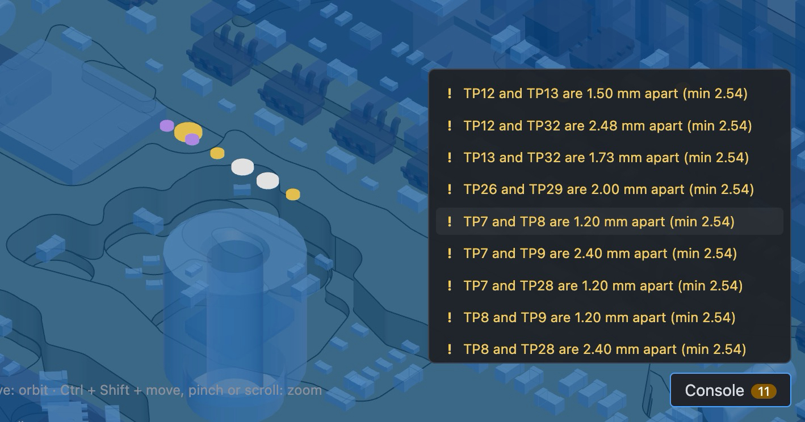

## Min floor { #min-floor }

**Default:** 1 mm · **Range:** 0 and above

The thinnest cardle floor the pocket may leave under a cavity. A cavity that would leave less goes through the cradle instead, together with whatever it surrounds, so no thin skin or loose piece is left.

The console notes when this happens.
