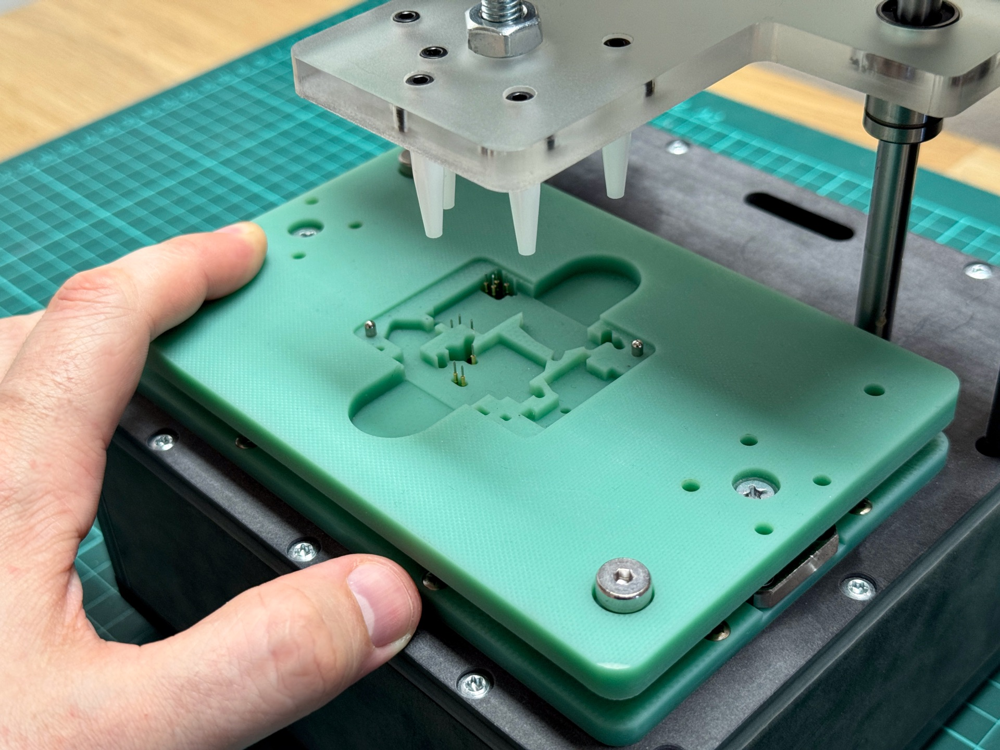
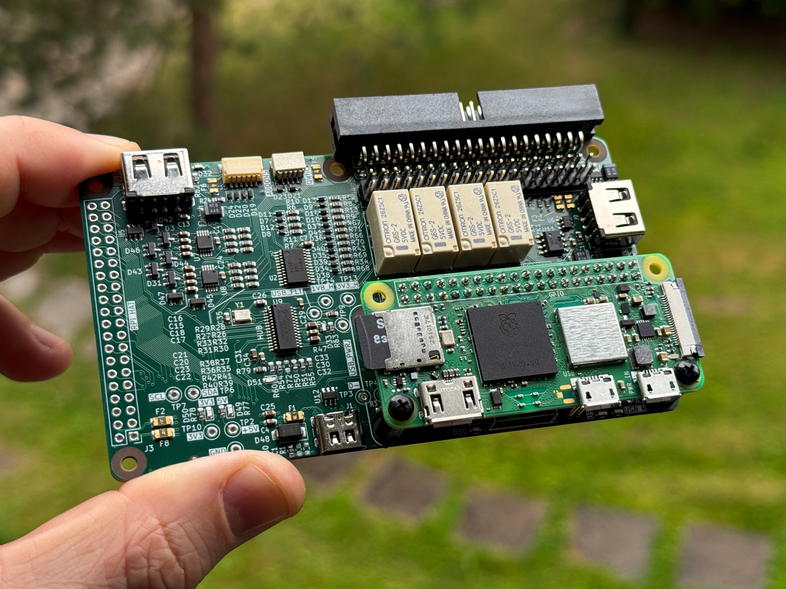

# Pinbot

Pinbot is an open-source platform for quickly building test jigs for electronics QA. The platform is made up of mechanical fixture, control electronics, cradle generator tools, jig-level software and backend to store all test results.

<iframe src="https://www.youtube-nocookie.com/embed/MzEMr3A7bvY" title="YouTube video" style="width: 100%; aspect-ratio: 16 / 9; border: 0" allow="accelerometer; autoplay; clipboard-write; encrypted-media; gyroscope; picture-in-picture; web-share" referrerpolicy="strict-origin-when-cross-origin" allowfullscreen></iframe>

## Mechanical chassis

[Pinbot-mechanical](https://github.com/Pinbot-factory/pinbot-mechanical) repository contains the mechanical design files for the Pinbot test jig along with minimal assembly documentation. The complete jig consists of two assemblies: chassis and cradle.

<figure markdown>
  
  <figcaption>Pinbot's test jig cassette for RPi CM5 module flashing and testing. Made of FR4 material. Milled.</figcaption>
</figure>

## Control electronics

[Pinbot-electronics](https://github.com/Pinbot-factory/pinbot-electronics) repo is dedicated for electronics of a typical Pinbot jig and it's software examples. At a moment it is a compact carrier board for Raspberry Pi Zero 2. The board also can be used with regular size RPis thru HAT connector.

<figure markdown>
  
  <figcaption>Pinbot's control board is based on RPi Zero 2 with USB hub, ADCs, expanders and relays.</figcaption>
</figure>

## Tools

Pinbot [cradle generator](cradle-generator/get-started.md) runs in the browser and makes the cradle of a Pinbot-180 test jig for your PCBA: the plate the board lies in while spring-loaded test probes (needles) touch its test points from below.

<figure markdown>
  
  <figcaption>Pinbot's cradle generator in browser.</figcaption>
</figure>